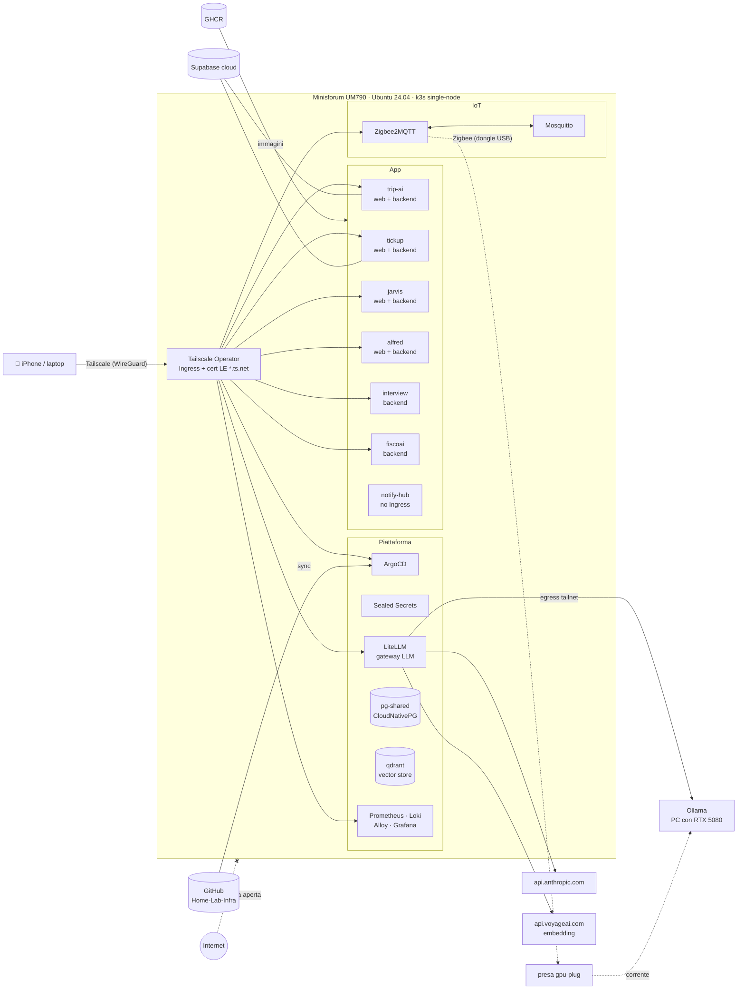
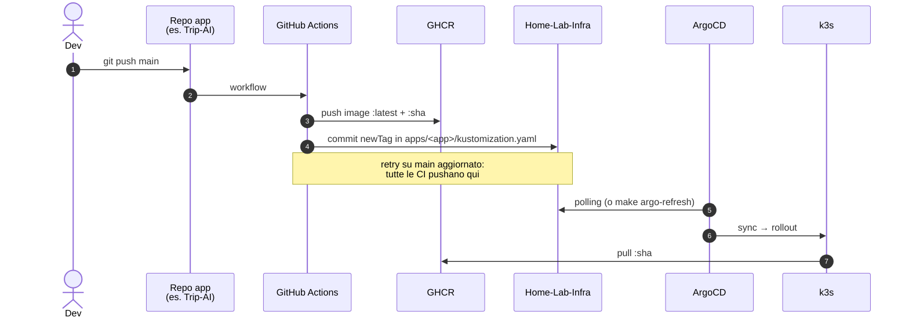
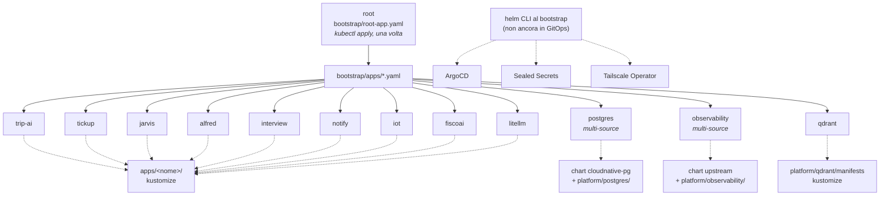
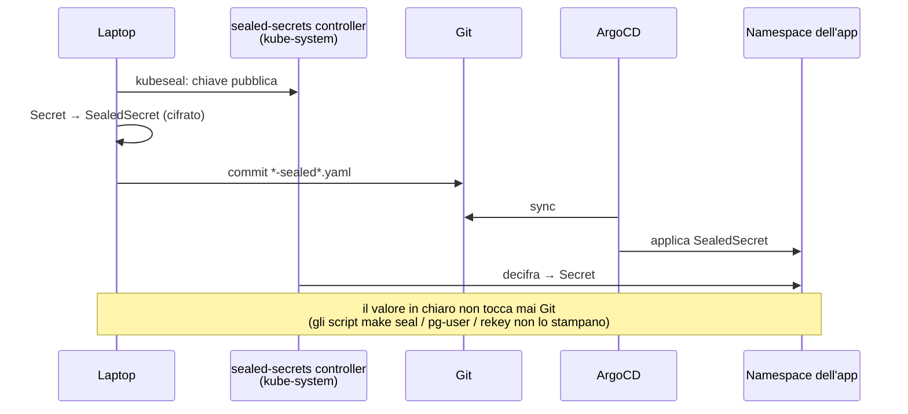
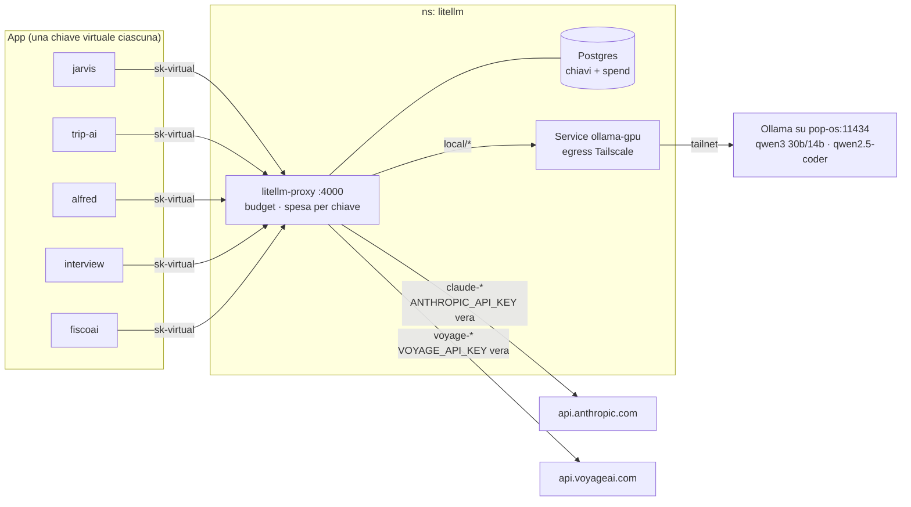
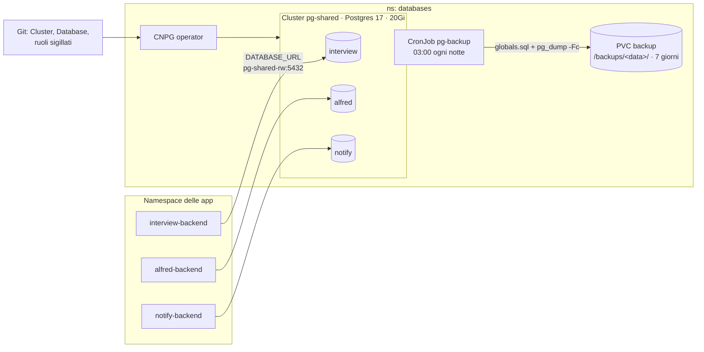
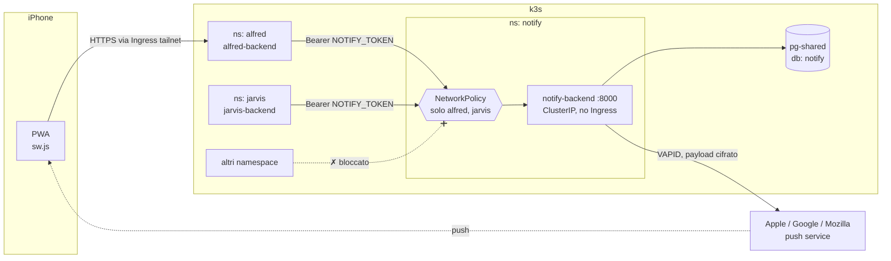
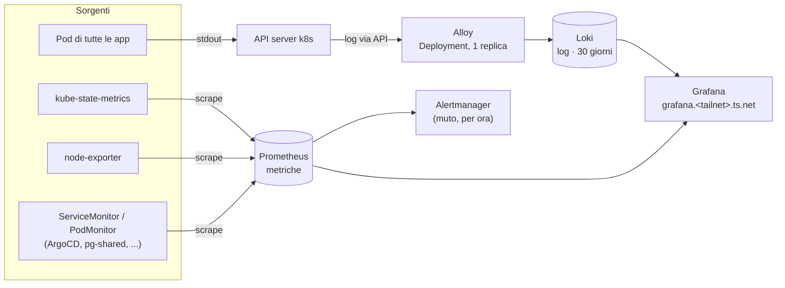

# 🏠 Homelab — k3s + GitOps

[](https://k3s.io)
[](https://argo-cd.readthedocs.io)
[](https://tailscale.com)
[](LICENSE)

Repo **source-of-truth** di un homelab Kubernetes su Minisforum UM790: tutto ciò
che gira sul cluster è descritto qui e sincronizzato da ArgoCD. Nessuna porta
aperta su Internet, nessun segreto in chiaro, nessun `kubectl apply` a mano
dopo il bootstrap. Obiettivo: infra comune per le mie app e palestra di architettura.

> 🇬🇧 **In short:** a single-node k3s cluster managed entirely via GitOps
> (ArgoCD app-of-apps), reachable only over a Tailscale tailnet, with Sealed
> Secrets, CloudNativePG, an LLM gateway (LiteLLM) and a Prometheus/Loki/Grafana
> stack. Docs are in Italian; the manifests and Makefile are easy to adapt.

## Indice

- [Stack](#stack) · [Architettura](#architettura) · [Flusso di deploy](#flusso-di-deploy-gitops) · [Struttura](#struttura)
- [Comandi quotidiani](#comandi-quotidiani) · [Bootstrap](#bootstrap-del-cluster-una-volta-sola) · [Nuova app](#aggiungere-una-nuova-app-il-pattern)
- [Gateway LLM](#gateway-llm-litellm) · [Postgres](#postgres-condiviso-cloudnativepg) · [Qdrant](#qdrant-condiviso) · [Notifiche](#notifiche-notify-hub) · [Zigbee e GPU](#zigbee-e-gpu-iot) · [Observability](#observability)
- [Adattarlo al tuo setup](#adattarlo-al-tuo-setup) · [Roadmap](#fasi-future) · [Licenza](#licenza)

## Stack

| Livello | Tecnologia |
|---|---|
| Kubernetes | k3s single-node (Ubuntu 24.04), Traefik disabilitato |
| GitOps | ArgoCD, pattern app-of-apps, Kustomize + Helm multi-source |
| Rete / accesso | Tailscale Operator (Ingress + certificati Let's Encrypt `*.ts.net`) |
| Segreti | Sealed Secrets (cifrati e committati in Git) |
| Database | CloudNativePG (`pg-shared`), Supabase cloud per alcune app |
| LLM | LiteLLM (chiavi virtuali, budget) → Claude + Ollama locale su GPU |
| Osservabilità | kube-prometheus-stack, Loki, Alloy, Grafana |
| IoT | Zigbee2MQTT + Mosquitto, dongle Sonoff ZBDongle-E, prese Sonoff S60ZBTPF |
| CI/CD | GitHub Actions nei repo delle app → GHCR → bump del tag qui |

## Architettura

Nessuna porta aperta sul router: l'unica via d'ingresso è la tailnet. Ogni
Ingress `ingressClassName: tailscale` diventa un device della tailnet con il suo
certificato Let's Encrypt `*.ts.net`.



| Hostname (`<nome>.<tailnet>.ts.net`) | Servizio |
|---|---|
| `argocd` | UI di ArgoCD |
| `grafana` | Grafana (metriche + log) |
| `litellm` | UI di LiteLLM (chiavi virtuali, spesa) |
| `trip-ai` · `tickup` · `jarvis` · `alfred` | PWA web, `/api/*` → backend |
| `interview` | Interview Trainer |
| `fiscoai` | FiscoAI (CRM + RAG per commercialisti) |
| `zigbee` | UI di Zigbee2MQTT |

**Dove stanno i dati:** Supabase (cloud) per Trip-AI e TickUp; `pg-shared`
in-cluster per Interview Trainer, Alfred, notify-hub e FiscoAI; vettori sul
Qdrant condiviso (FiscoAI); upload di FiscoAI su un PVC suo. LiteLLM ha ancora
il suo Postgres. Le immagini sono su GHCR, buildate da GitHub Actions nei repo delle app.

## Flusso di deploy (GitOps)

1. Push su `main` nel repo dell'app (es. Trip-AI)
2. GitHub Actions builda l'immagine → push su GHCR (`:latest` + `:<sha>`)
3. Il workflow committa il nuovo tag in `apps/<app>/kustomization.yaml` **qui**
4. ArgoCD vede il commit e rolla la nuova versione — nessun comando sul server



### App-of-apps

L'unica cosa applicata a mano è `bootstrap/root-app.yaml`. Lei sincronizza
`bootstrap/apps/`, dove vive una `Application` per componente: aggiungere un'app
al cluster = aggiungere un YAML lì e pushare.



## Struttura

```
bootstrap/root-app.yaml     # UNICA cosa applicata a mano: l'app-of-apps
bootstrap/apps/*.yaml       # le Application ArgoCD (una per app)
platform/                   # componenti piattaforma: values helm + manifest
  argocd/                   # values + ingress tailnet della UI
  sealed-secrets/
  tailscale-operator/
  observability/            # values helm dello stack + manifest (ns, password Grafana)
  postgres/                 # values dell'operator CNPG + Cluster pg-shared, DB, ruoli, backup
apps/
  trip-ai/                  # manifest kustomize dell'app (Deployment/Service/Ingress/secrets)
  jarvis/                   # come trip-ai + ServiceAccount e ClusterRole di sola lettura
  litellm/                  # gateway LLM: proxy + Postgres + egress verso Ollama
  interview/                # Interview Trainer: backend FastAPI su pg-shared
  tickup/                   # come trip-ai (Supabase cloud come DB)
  alfred/                   # assistente personale, client di notify-hub
  notify/                   # notify-hub: Web Push per le app del lab
  iot/                      # Zigbee2MQTT + Mosquitto: prese smart, accensione della GPU
scripts/                    # helper richiamati dal Makefile (seal, pg-user, rekey, ...)
legacy/                     # vecchio draft Caddy + docker-compose (riferimento storico)
```

## Comandi quotidiani

Il `Makefile` raccoglie i comandi ricorrenti (`make` da solo elenca tutto).
Convenzione: `APP` è il nome della cartella in `apps/` — che è anche il
namespace — e `COMP` è `backend` o `web`.

```bash
make ps                          # pod di tutte le app + piattaforma
make status                      # nodi, Application ArgoCD, ingress tailnet
make logs APP=tickup COMP=web    # log in follow
make logs-prev APP=tickup        # log del container morto (CrashLoopBackOff)
make sh APP=trip-ai              # shell nel pod
make restart APP=tickup          # rollout restart + attesa
make diff APP=tickup             # cosa c'è in Git vs cosa gira davvero
make validate                    # dry-run server-side di tutte le app
make seal APP=tickup ENV_FILE=~/tickup.env
make obs                         # pod e volumi dello stack di observability
make obs-pass                    # password admin di Grafana
```

Il Makefile non fa deploy: quello resta di ArgoCD (`make argo-refresh` al
massimo evita di aspettare il polling).

## Bootstrap del cluster (una volta sola)

Prerequisiti in admin console Tailscale: **MagicDNS** + **HTTPS Certificates**
abilitati; ACL con `tag:k8s-operator`/`tag:k8s` e un **OAuth client** taggato
`tag:k8s-operator` (scope: Devices Core + Auth Keys, write).

```bash
# 1. k3s senza Traefik (l'ingress lo fa il Tailscale Operator)
curl -sfL https://get.k3s.io | INSTALL_K3S_EXEC="--disable traefik" sh -
mkdir -p ~/.kube && sudo cp /etc/rancher/k3s/k3s.yaml ~/.kube/config \
  && sudo chown "$USER" ~/.kube/config

# 2. Helm + kubeseal CLI
# (helm: https://helm.sh/docs/intro/install/ · kubeseal: release GitHub sealed-secrets)

# 3. Componenti piattaforma
helm repo add argo https://argoproj.github.io/argo-helm
helm repo add sealed-secrets https://bitnami.github.io/sealed-secrets
helm repo add tailscale https://pkgs.tailscale.com/helmcharts
helm repo update

helm upgrade --install argocd argo/argo-cd -n argocd --create-namespace \
  -f platform/argocd/values.yaml
helm upgrade --install sealed-secrets sealed-secrets/sealed-secrets \
  -n kube-system -f platform/sealed-secrets/values.yaml
helm upgrade --install tailscale-operator tailscale/tailscale-operator \
  -n tailscale --create-namespace -f platform/tailscale-operator/values.yaml \
  --set-string oauth.clientId="$TS_CLIENT_ID" \
  --set-string oauth.clientSecret="$TS_CLIENT_SECRET"

# 4. Accesso ArgoCD → questo repo: deploy key in sola lettura (necessaria solo se il repo è privato)
ssh-keygen -t ed25519 -f /tmp/argocd-deploy -N "" -C argocd@homelab
# → aggiungi /tmp/argocd-deploy.pub come Deploy Key (read-only) del repo su GitHub
kubectl -n argocd create secret generic repo-home-lab-infra \
  --from-literal=type=git \
  --from-literal=url=git@github.com:gmottola00/Home-Lab-Infra.git \
  --from-file=sshPrivateKey=/tmp/argocd-deploy
kubectl -n argocd label secret repo-home-lab-infra \
  argocd.argoproj.io/secret-type=repository

# 5. UI ArgoCD sulla tailnet + password iniziale
kubectl apply -f platform/argocd/ingress.yaml
kubectl -n argocd get secret argocd-initial-admin-secret \
  -o jsonpath='{.data.password}' | base64 -d; echo

# 6. Accendi tutto: da qui in poi comanda Git
kubectl apply -f bootstrap/root-app.yaml
```

> Nota: ArgoCD, Sealed Secrets e l'operator sono installati via helm CLI al
> bootstrap e non ancora auto-gestiti da ArgoCD (upgrade = `helm upgrade` con
> gli stessi comandi). Lo stack di observability invece è già in GitOps, con
> Application multi-source: è il pattern da estendere anche a questi tre.

## Aggiungere una nuova app (il pattern)

1. Nel repo dell'app: `Dockerfile` (+ eventuale `Dockerfile.web`) e workflow CI
   che pushano su GHCR e bumpano il tag qui (copiare da Trip-AI)
2. Qui: cartella `apps/<nome>/` con kustomize (Namespace, Deployment, Service,
   Ingress `ingressClassName: tailscale`, secrets sigillati)
3. Secrets: `kubeseal` (vedi sotto) — mai secret in chiaro su Git
4. Qui: `bootstrap/apps/<nome>.yaml` (Application ArgoCD)
5. Push → l'app-of-apps la raccoglie da sola

### Sigillare un secret

```bash
kubectl create secret generic <nome> -n <namespace> \
  --from-literal=CHIAVE=valore --dry-run=client -o yaml \
  | kubeseal --controller-namespace kube-system -o yaml \
  > apps/<app>/sealed-secret.yaml
```

Il file cifrato è committabile: solo il controller nel cluster può decifrarlo.



## Gateway LLM (LiteLLM)

Tutte le chiamate ai modelli delle app passano da LiteLLM. La vera
`ANTHROPIC_API_KEY` vive solo in `litellm-secrets`; le app hanno una **chiave
virtuale** ciascuna, revocabile e con budget, e la spesa si vede per chiave su
`https://litellm.<tailnet>.ts.net/ui` (login con la master key).



| Endpoint (dal cluster) | Per cosa |
|---|---|
| `http://litellm-proxy.litellm.svc.cluster.local:4000/anthropic` | Claude con l'API nativa (pass-through: thinking, effort, structured outputs invariati) |
| `http://litellm-proxy.litellm.svc.cluster.local:4000/v1/messages` | formato Anthropic verso qualsiasi modello, anche `local/*` (LiteLLM traduce per Ollama) |
| `http://litellm-proxy.litellm.svc.cluster.local:4000/v1` | API OpenAI-compatibile: `/chat/completions` per tutti i modelli, `/embeddings` per `voyage-*` (interview, FiscoAI) |

I modelli sono in `apps/litellm/config.yaml`: `claude-*` sono Anthropic,
`voyage-*` sono embedding Voyage AI (`VOYAGE_API_KEY` in `litellm-secrets`),
`local/*` sono Ollama sul PC fisso, raggiunto dal Service `ollama-gpu` (egress
del Tailscale Operator verso `pop-os`). **Nessun fallback silenzioso** da
`local/*` a Claude: a PC spento la richiesta fallisce dopo `stream_timeout`
(30 s) e il consenso a passare a Claude lo chiede Jarvis all'utente. Le ACL
della tailnet devono permettere `tag:k8s` → `pop-os:11434`.

**Primo deploy:**

```bash
# 1. secret (valori veri solo nel file locale, mai in Git)
cat > /tmp/litellm.env <<'ENV'
LITELLM_MASTER_KEY=sk-<random>
LITELLM_SALT_KEY=sk-<random, non cambiarlo più: cifra le chiavi nel DB>
ANTHROPIC_API_KEY=sk-ant-...
POSTGRES_PASSWORD=<random>
DATABASE_URL=postgresql://litellm:<stessa password>@litellm-postgres:5432/litellm
ENV
make seal APP=litellm ENV_FILE=/tmp/litellm.env && rm /tmp/litellm.env
# 2. commit + push → ArgoCD crea namespace, Postgres e proxy
# 3. una chiave virtuale per app: la crea e risigilla il secret dell'app con
#    quella al posto della chiave vera (gli altri valori restano come sono)
make litellm-rekey APP=jarvis BUDGET=20
make litellm-rekey APP=trip-ai BUDGET=20
# 4. commit + push, poi riavvia i backend (un secret nuovo non li riavvia da solo)
kubectl -n jarvis rollout restart deploy/jarvis-backend
kubectl -n trip-ai rollout restart deploy/trip-ai-backend
```

Trip-AI non ha filtro sui modelli: usa id datati (`claude-haiku-4-5-20251001`)
che il pass-through inoltra così come sono, ma che non sono nomi di
`config.yaml`. Gli alias delle chiavi sono unici: per rifare la chiave di
un'app revoca prima quella vecchia dalla UI (Virtual Keys → Delete).

## Postgres condiviso (CloudNativePG)

Un solo server Postgres per le app del cluster, `pg-shared` nel namespace
`databases`, gestito dall'operator **CloudNativePG**. Ogni app ha in Git il suo
database e il suo ruolo; l'operator li crea e ne mantiene la password.



| Pezzo | Dove |
|---|---|
| operator (chart `cloudnative-pg`) | `bootstrap/apps/postgres.yaml` → `cnpg-operator`, values in `platform/postgres/cnpg-values.yaml` |
| Cluster `pg-shared` (1 istanza, Postgres 17, 20Gi) + ruoli | `platform/postgres/manifests/cluster.yaml` |
| un `Database` per app | `platform/postgres/manifests/databases/<app>.yaml` |
| password dei ruoli (sigillate) | `platform/postgres/manifests/roles/<app>-sealed.yaml` |
| dump notturni | `platform/postgres/manifests/backup.yaml` |

Endpoint per le app: `pg-shared-rw.databases.svc.cluster.local:5432`.

**Aggiungere il database di un'app** (es. `foo`, con `apps/foo/` già esistente):

1. In `cluster.yaml`, sotto `managed.roles`, un ruolo `foo` con `passwordSecret: pg-role-foo`.
2. `databases/foo.yaml` (copia di `interview.yaml`), e le righe
   `databases/foo.yaml` e `roles/foo-sealed.yaml` in `platform/postgres/manifests/kustomization.yaml`.
3. `make pg-user APP=foo`: genera la password e sigilla `roles/foo-sealed.yaml` (per
   CNPG) e `apps/foo/db-sealed-secret.yaml` (Secret `foo-db` con `DATABASE_URL`, da
   montare nel Deployment con `envFrom`). La password non passa dal terminale.
4. Aggiungi `db-sealed-secret.yaml` alla kustomization dell'app, poi commit e push.

```bash
make pg-status                # cluster, database, ruoli, pod, PVC, job di backup
make pg-psql DB=interview     # psql come superuser nel primary
make pg-backup                # backup subito (job dal CronJob) con i log
make pg-backups               # elenco dei dump sul volume
```

**Backup.** Ogni notte alle 03:00 il CronJob `pg-backup` scrive in
`/backups/<data>/` `globals.sql` (ruoli) e un `pg_dump -Fc` per ogni database, e
tiene 7 giorni. Sono sullo stesso disco del database: proteggono da errori (DROP,
migrazione sbagliata, Cluster cancellato), non da un guasto del disco. Il passo
successivo è portarli fuori (S3). Restore di un DB:

```bash
# dal pod di un job o di `make pg-backups` con il volume montato
pg_restore -h pg-shared-rw -U postgres -d <db> --clean --if-exists /backups/<data>/<db>.dump
```

> **Attenzione:** l'unica StorageClass (`local-path`) ha `reclaimPolicy: Delete`.
> Cancellare il Cluster, il suo PVC o il namespace `databases` cancella i dati.
> Per questo Cluster, PVC dei backup e namespace hanno
> `argocd.argoproj.io/sync-options: Prune=false,Delete=false`: ArgoCD non li
> rimuove nemmeno se spariscono da Git. Un `Database` tolto da Git non fa
> `DROP DATABASE` (`databaseReclaimPolicy: retain`).

LiteLLM resta per ora sul suo Postgres (`apps/litellm/postgres.yaml`); il
trasloco su `pg-shared` è un passo successivo.

## Qdrant condiviso

`platform/qdrant/manifests`: un Qdrant per tutte le app RAG del lab, Application
`qdrant` (wave 1). StatefulSet a replica singola su `local-path` (10Gi), come il
Postgres di LiteLLM: niente chart, niente cluster mode.

| | |
|---|---|
| Endpoint | `http://qdrant.qdrant.svc.cluster.local:6333` (REST), `:6334` (gRPC) |
| Accesso | chiave API unica in `qdrant-secrets` (`make qdrant-key`) + NetworkPolicy che ammette solo i namespace delle app, `monitoring` e `tailscale` |
| Metriche | ServiceMonitor su `/metrics` (con la chiave) |
| Dashboard | `https://qdrant.<tailnet>.ts.net/dashboard` (ingress Tailscale), chiave da `make qdrant-pass`. Senza tailnet: `make qdrant-pf` → `http://localhost:6333/dashboard` |

**Aggiungere un'app** (es. `foo`):

1. `foo` nella lista di `platform/qdrant/manifests/networkpolicy.yaml`
2. `make qdrant-key APP=foo`: copia la chiave dal cluster in `foo-secrets`
   come `QDRANT_API_KEY` (risigilla `apps/foo/sealed-secret.yaml` tenendo gli
   altri valori)
3. `QDRANT_URL` nel configMap dell'app; collection con il nome dell'app come
   prefisso

I vettori non hanno backup: si ricostruiscono dalle app (FiscoAI: reindex dei
documenti). Namespace e volume hanno comunque `Prune=false,Delete=false`.

## Notifiche (notify-hub)

`apps/notify/`: il servizio Web Push del lab (codice nel repo `Notify-Hub`). Tiene la chiave VAPID e le sottoscrizioni per app su `pg-shared/notify`, e consegna ad Apple, Mozilla e Google. **Nessun Ingress:** una NetworkPolicy ammette solo i namespace `alfred` e `jarvis`; il token identifica l'app, e in Git ne sta solo lo sha256 (`NOTIFY_APPS`).



Primo deploy:

```bash
make pg-user APP=notify          # ruolo + DATABASE_URL
make notify-vapid                # chiave VAPID (rigenerarla invalida TUTTE le sottoscrizioni)
make ghcr-pull APP=notify        # pull secret copiato da alfred
make notify-token APP=alfred     # NOTIFY_TOKEN di Alfred + hash in NOTIFY_APPS
make notify-subs                 # dispositivi iscritti
```

## Zigbee e GPU (`iot`)

Un dongle **Sonoff ZBDongle-E** sul nodo e due prese **Sonoff S60ZBTPF** (misurano i watt):

| Presa | Alimenta | Regola |
|---|---|---|
| `gpu-plug` | PC fisso `pop-os` (RTX 5080, Ollama) | si accende e spegne con `make gpu-on` / `make gpu-off` |
| `homelab-plug` | **questo nodo** | ⚠️ **mai spenta**: il cluster cadrebbe e niente potrebbe riaccenderlo. Solo misura |

Zigbee2MQTT (`apps/iot/zigbee2mqtt.yaml`) apre la seriale con un `hostPath` sul
path `/dev/serial/by-id/...` e pubblica su Mosquitto (`apps/iot/mosquitto.yaml`),
che resta dentro il cluster. La UI è su `https://zigbee.<tailnet>.ts.net`.
`config/configuration.yaml` viene copiato sulla PVC a ogni avvio, quindi le
impostazioni si cambiano in Git. Nomi e opzioni dei device stanno invece in
`devices.yaml` sulla PVC. La network key è nel Secret sigillato `iot-secrets`:
se la PVC si perde, la rete si ricostruisce senza riassociare le prese.

```bash
make iot-secrets      # password MQTT (+ network key al primo giro, poi la riusa)
make zigbee-pair      # join aperto 2 minuti → tasto della presa premuto ~5s
make gpu-status       # presa, watt, pop-os sulla tailnet, Ollama
make gpu-on           # presa ON → il BIOS accende il PC → aspetta Ollama
make gpu-off          # shutdown via SSH → watt sotto soglia → presa OFF
```

`gpu-off` non stacca mai la corrente a un PC acceso: se lo shutdown via SSH
fallisce o i watt non scendono entro 3 minuti, la presa resta ON.

**Setup una tantum** (pairing, BIOS e SSH su pop-os, prova end-to-end): checklist in
[`apps/iot/README.md`](apps/iot/README.md).

Home Assistant in futuro: `homeassistant.enabled: true` nel config, un utente
MQTT in più e il suo namespace in `apps/iot/networkpolicy.yaml`.

## Observability

Metriche e log di tutto il cluster, su `https://grafana.<tailnet>.ts.net`
(`make obs-pass` per la password admin).

| Pezzo | Cosa fa |
|---|---|
| kube-prometheus-stack | Prometheus + Alertmanager + Grafana + kube-state-metrics + node-exporter |
| Loki | archivio dei log, retention 30 giorni |
| Alloy | legge i log dei pod e li spedisce a Loki (sostituisce Promtail, EOL da marzo 2026) |



Cosa risolve, in concreto: `make logs-prev` mostra i log di **un solo** crash e li
perde al riavvio successivo. In Loki i log del pod distrutto restano, e si cercano
per namespace/pod/container/`app`:

```logql
{namespace="tickup"}                          # tutto il namespace
{app="tickup-backend"} |= "ERROR"             # solo gli errori del backend
```

Le tre Application (`kube-prometheus-stack`, `loki`, `alloy`) sono le prime
**multi-source**: la prima source è il chart Helm upstream, la seconda è questo repo
referenziato come `$values` dai `valueFiles`. Il chart resta upstream, la sua
configurazione resta versionata qui — è il pattern con cui adottare in futuro anche
ArgoCD, l'operator e sealed-secrets nel loop GitOps.

Tre scelte che sembrano strane e non lo sono:

- **Il control-plane k3s non viene raccolto.** Scheduler, controller-manager e proxy
  girano dentro l'unico processo k3s e bindano su `127.0.0.1`; etcd non esiste
  (sqlite embedded). Esporli richiederebbe flag in `/etc/rancher/k3s/config.yaml`
  sull'host, cioè configurazione fuori da Git, e su un single-node direbbero poco.
  I relativi scrape job **e le loro alert** sono spenti nei values: un target down
  per sempre insegna solo a ignorare le notifiche.
- **Alertmanager è installato ma muto.** Nessun receiver esterno finché non sappiamo
  quali alert sono davvero utili; per ora si guardano dalla UI.
- **Alloy è un Deployment a replica singola, non un DaemonSet.** Legge i log
  dall'API server, non dal filesystem del nodo: un DaemonSet farebbe vedere a ogni
  replica tutti i pod del cluster e, il giorno in cui Jarvis entra come secondo
  nodo, ogni riga arriverebbe a Loki due volte.

Se una metrica manca, si parte sempre da `make obs-targets` (target di scrape down).

### Metriche di ArgoCD

I Service `metrics` di ArgoCD sono spenti di default nel chart. Sono abilitati in
`platform/argocd/values.yaml`, ma vanno applicati con un `helm upgrade` **dopo** il
primo sync di kube-prometheus-stack — i ServiceMonitor sono CRD del Prometheus
Operator e prima non esistono:

```bash
helm upgrade --install argocd argo/argo-cd -n argocd -f platform/argocd/values.yaml
```

## Fasi future

- [x] Trip-AI online end-to-end (backend + PWA web)
- [x] **TickUp**: stesso pattern di Trip-AI (Supabase cloud come DB, niente
      Postgres/Redis in-cluster: Redis è inutilizzato nel codice e lo scheduling
      è APScheduler in-process → backend a replica singola)
- [x] **Observability**: kube-prometheus-stack + Grafana + Loki
- [x] **Jarvis (app)**: agente + console read-only del cluster, stesso pattern
      di Trip-AI più RBAC (ServiceAccount `jarvis` con ClusterRole `jarvis-reader`,
      niente accesso ai Secret). Stato in memoria → replica singola
- [x] **Gateway LLM**: LiteLLM + Postgres in-cluster, chiavi virtuali per app,
      Ollama sul PC fisso (RTX 5080) via egress tailnet con fallback su Claude
- [x] **Postgres condiviso**: CloudNativePG, `pg-shared` con un database per app
      dichiarato in Git, dump notturni su volume
- [x] **Interview Trainer**: primo utente di `pg-shared`, generazione su GPU e
      valutazione su Haiku via LiteLLM, dati migrati da SQLite
- [x] **Notifiche (notify-hub)**: Web Push per le app del lab, una chiave VAPID
      e un token per app, niente Ingress; primo client Alfred
- [x] **FiscoAI**: CRM + RAG per commercialisti su `pg-shared`, primo utente
      del Qdrant condiviso e degli embedding Voyage via LiteLLM; upload su PVC
      con tar notturno
- [ ] Qdrant: chiavi per app (JWT RBAC per collection) al posto della chiave
      unica, snapshot periodici
- [ ] Regole di notifica in Alfred, webhook di Alertmanager verso notify-hub
- [ ] Backup di `pg-shared` e degli upload di FiscoAI fuori dal nodo (S3 / barman-cloud) e LiteLLM su `pg-shared`
- [x] **Zigbee + accensione GPU**: Zigbee2MQTT + Mosquitto, presa smart al posto
      del Wake-on-LAN, `make gpu-on` / `gpu-off` con shutdown pulito
- [ ] Home Assistant come client MQTT di Zigbee2MQTT
- [ ] **Jarvis (GPU)**: accensione GPU come tool di Jarvis, poi PC fisso come
      k3s agent on-demand, orchestratore + MCP
- [ ] Auto-gestione della piattaforma: ArgoCD/operator/sealed-secrets adottati
      nel loop GitOps (app-of-apps anche per platform/)

## Adattarlo al tuo setup

La repo è pensata per il mio cluster, ma il pattern è riutilizzabile. Cosa cambiare:

1. **Tailnet**: sostituisci `tail682dc3.ts.net` con il tuo (`grep -r ts.net`) e i nomi host in `apps/*/ingress*.yaml`.
2. **Repo URL**: `bootstrap/root-app.yaml` e `bootstrap/apps/*.yaml` puntano a `gmottola00/Home-Lab-Infra`.
3. **Secret**: i `*-sealed*.yaml` sono cifrati con la chiave del *mio* controller e **non sono decifrabili da te**. Rigenerali con `make seal` / `make pg-user` / `make litellm-rekey`.
4. **Immagini**: i Deployment puntano a immagini GHCR delle mie app; sostituiscile con le tue o parti dal pattern in [Aggiungere una nuova app](#aggiungere-una-nuova-app-il-pattern).
5. **Hardware**: lo storage usa `local-path` (single-node) e Ollama è su un PC `pop-os` raggiunto via tailnet: adatta o rimuovi `apps/litellm`.

## Licenza

[MIT](LICENSE) © Gianmarco Mottola. I manifest sono forniti così come sono,
senza garanzie: rivedi sempre cosa applichi al tuo cluster.
