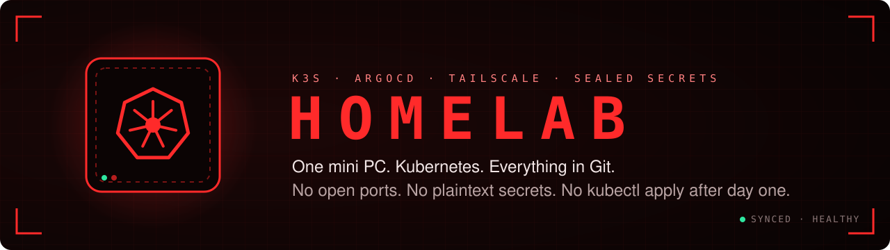
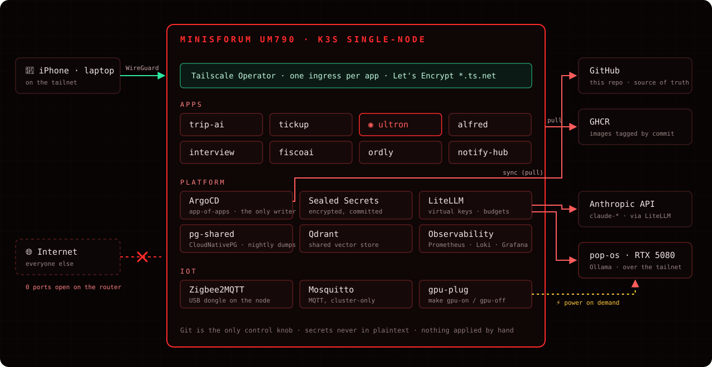
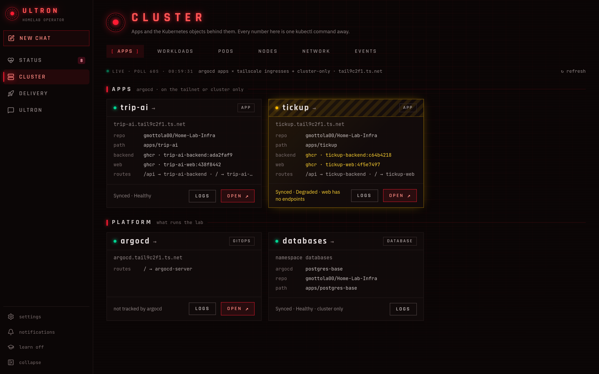
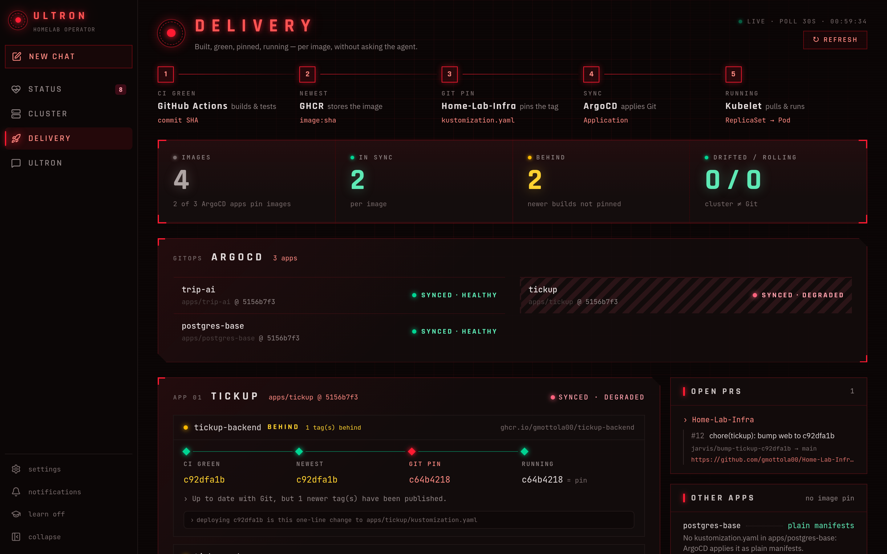
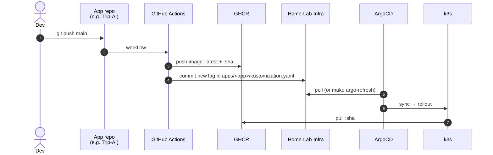

<div align="center">



[](https://k3s.io)
[](https://argo-cd.readthedocs.io)
[](https://tailscale.com)
[](https://github.com/bitnami-labs/sealed-secrets)
[](https://cloudnative-pg.io)
[](LICENSE)

**A production-shaped Kubernetes platform on a single mini PC, managed entirely through Git,
and operated by an AI agent that can only open pull requests.**

[Architecture](#-architecture) · [Ultron](#-operated-by-ultron) · [How a deploy works](#-how-a-deploy-works) · [Add an app](#-add-an-app-in-five-steps) · [Make it yours](#-make-it-yours) · [🇮🇹 Full guide](README.it.md)

<br>

| 🖥️ **1** node | 📦 **10** apps | 🔐 **12** private HTTPS hosts | 🚪 **0** open ports | 🙈 **0** plaintext secrets | 🛠️ **50** `make` targets |
|:---:|:---:|:---:|:---:|:---:|:---:|

</div>

---

## 🧭 Why this repo exists

Most homelabs are a pile of `docker run` commands nobody can reproduce. This one is the
opposite: **everything that runs on the cluster is described here**, and ArgoCD makes the
cluster match it. After the one-time bootstrap nobody runs `kubectl apply` by hand: you push,
and the lab converges.

It hosts my own apps (an AI travel planner, a skill-game platform, a CRM with RAG for
accountants, an ordering system for food businesses, an interview trainer, a personal finance
butler) on the same patterns a real platform team would use, at the scale of a shoebox.

<table>
<tr>
<td width="33%" valign="top">

### 🚪 Invisible from the internet
No port forwarding, no public IP. Every app gets its own HTTPS hostname on the
**Tailscale tailnet**, with a real Let's Encrypt certificate. If you're not on the tailnet,
the lab does not exist.

</td>
<td width="33%" valign="top">

### 🔁 Git is the only control knob
**ArgoCD app-of-apps**: one `kubectl apply` on day one, then adding an app is adding a YAML
file. CI in each app repo pins the new image tag here, and ArgoCD rolls it out. Undo is
`git revert`.

</td>
<td width="33%" valign="top">

### 🔐 Secrets live in Git, encrypted
**Sealed Secrets**: only the controller in the cluster can decrypt them. The helper scripts
(`make seal`, `make pg-user`, `make litellm-rekey`) never print a plaintext value.

</td>
</tr>
<tr>
<td width="33%" valign="top">

### 🧠 An LLM gateway for every app
**LiteLLM** holds the real API keys. Each app gets a revocable virtual key with a budget,
and calls Claude or local models on a GPU desktop through the same endpoint.

</td>
<td width="33%" valign="top">

### ⚡ A GPU that turns itself on
The RTX 5080 desktop is off until needed. A **Zigbee smart plug** driven from the cluster
powers it on, waits for Ollama, and shuts it down cleanly: `make gpu-on`, `make gpu-off`.

</td>
<td width="33%" valign="top">

### 📈 Observed like production
**Prometheus, Loki, Alloy and Grafana**, a shared **CloudNativePG** Postgres with nightly
dumps, a shared **Qdrant** for RAG, and Web Push notifications for every app.

</td>
</tr>
</table>

---

## 🏗️ Architecture



| Layer | Technology |
|---|---|
| Kubernetes | k3s single-node on a Minisforum UM790 (Ubuntu 24.04), Traefik disabled |
| GitOps | ArgoCD, app-of-apps, Kustomize + Helm multi-source |
| Network | Tailscale Operator: an Ingress per app, Let's Encrypt `*.ts.net` certificates |
| Secrets | Sealed Secrets, encrypted and committed |
| Data | CloudNativePG (`pg-shared`, one database per app, declared in Git), Qdrant, Supabase cloud for two apps |
| LLM | LiteLLM (virtual keys, budgets) → Claude, Voyage embeddings, Ollama on a GPU desktop |
| Observability | kube-prometheus-stack, Loki, Alloy, Grafana |
| IoT | Zigbee2MQTT + Mosquitto, Sonoff ZBDongle-E, Sonoff S60ZBTPF power-metering plugs |
| CI/CD | GitHub Actions in each app repo → GHCR → tag bump in this repo |

---

## 🤖 Operated by Ultron

The lab has its own operator: [**Ultron**](https://github.com/gmottola00/Ultron-Home-Lab), an
AI agent that reads Kubernetes, Prometheus, Loki, ArgoCD and GitHub, and **writes only to this
repo, as pull requests**. It runs inside the cluster it operates, with a read-only ClusterRole
and no access to Secrets. ArgoCD stays the only thing that changes the cluster.


<table>
<tr>
<td width="50%"><br><sub><b>Cluster</b>: every app in <code>apps/</code>, its pinned images, routes and ArgoCD state.</sub></td>
<td width="50%"><br><sub><b>Delivery</b>: CI green → GHCR → tag pinned here → ArgoCD → running, per image.</sub></td>
</tr>
</table>

<sub>Screenshots from Ultron's offline demo, which mirrors this repo's layout.</sub>

---

## 🚀 How a deploy works

Nobody deploys. A push does.



The only manifest ever applied by hand is `bootstrap/root-app.yaml`. It syncs
`bootstrap/apps/`, which holds one ArgoCD `Application` per component.

```
bootstrap/root-app.yaml     the one thing applied by hand: the app-of-apps
bootstrap/apps/*.yaml       one ArgoCD Application per component
platform/                   argocd, sealed-secrets, tailscale-operator, observability, postgres, qdrant
apps/<name>/                one kustomize folder per app; the folder name is the namespace
scripts/                    helpers behind the Makefile (seal, pg-user, rekey, gpu power, ...)
```

---

## ➕ Add an app in five steps

1. **In the app repo:** a `Dockerfile` and a CI workflow that pushes to GHCR and bumps the tag here (copy Trip-AI's).
2. **Here:** `apps/<name>/` with kustomize: Namespace, Deployment, Service, Ingress with `ingressClassName: tailscale`.
3. **Secrets:** `make seal APP=<name> ENV_FILE=~/name.env`. Never a plaintext secret in Git.
4. **Here:** `bootstrap/apps/<name>.yaml`, the ArgoCD `Application`.
5. **Push.** The app-of-apps picks it up, and `https://<name>.<tailnet>.ts.net` is live.

Need a database? `make pg-user APP=<name>` declares a database and role on `pg-shared` and
seals its `DATABASE_URL`. An LLM? `make litellm-rekey APP=<name> BUDGET=20` gives it a
budgeted virtual key.

---

## 🛠️ Day to day

`make` alone lists all 50 targets. `APP` is a folder in `apps/` (and its namespace), `COMP` is `backend` or `web`.

```bash
make ps                          # pods of every app and the platform
make status                      # nodes, ArgoCD apps, tailnet ingresses
make logs APP=tickup COMP=web    # follow logs
make logs-prev APP=tickup        # logs of the dead container (CrashLoopBackOff)
make diff APP=tickup             # what Git says vs what actually runs
make validate                    # server-side dry run of every app
make gpu-on                      # smart plug on → BIOS boots the desktop → wait for Ollama
```

The Makefile never deploys. That stays ArgoCD's job.

---

## 🧩 Make it yours

The repo is built for my cluster, but every pattern is reusable:

1. **Tailnet:** replace `tail682dc3.ts.net` with yours (`grep -r ts.net`) and the hostnames in `apps/*/ingress*.yaml`.
2. **Repo URL:** `bootstrap/root-app.yaml` and `bootstrap/apps/*.yaml` point at `gmottola00/Home-Lab-Infra`.
3. **Secrets:** the `*-sealed*.yaml` files are encrypted with *my* controller's key and are useless to you. Regenerate them with `make seal`, `make pg-user`, `make litellm-rekey`.
4. **Images:** the Deployments run my apps from GHCR. Swap in yours, or start from [the five steps](#-add-an-app-in-five-steps).
5. **Hardware:** storage is `local-path` (single node) and Ollama runs on a desktop called `pop-os`. Adapt or drop `apps/litellm` and `apps/iot`.

Bootstrapping a fresh node (k3s without Traefik, Helm installs of ArgoCD, Sealed Secrets and
the Tailscale Operator, then `kubectl apply -f bootstrap/root-app.yaml`) takes six commands:
see [the bootstrap section](README.it.md#bootstrap-del-cluster-una-volta-sola) of the full guide.

---

## 📚 Deep dives

The full operations guide is in Italian, in [README.it.md](README.it.md):

| Topic | What's there |
|---|---|
| [Bootstrap](README.it.md#bootstrap-del-cluster-una-volta-sola) | From a bare Ubuntu box to a synced cluster |
| [Sealed secrets](README.it.md#sigillare-un-secret) | How sealing works and why plaintext never touches Git |
| [LLM gateway](README.it.md#gateway-llm-litellm) | LiteLLM endpoints, virtual keys, local models, no silent fallback |
| [Shared Postgres](README.it.md#postgres-condiviso-cloudnativepg) | CloudNativePG, a database per app, nightly backups |
| [Qdrant](README.it.md#qdrant-condiviso) | The shared vector store and its NetworkPolicy |
| [Notifications](README.it.md#notifiche-notify-hub) | notify-hub: Web Push with no Ingress |
| [Zigbee and GPU](README.it.md#zigbee-e-gpu-iot) | Pairing, power metering, safe `gpu-off` |
| [Observability](README.it.md#observability) | The stack, and three choices that look odd but aren't |

## 🛣️ Roadmap

- [ ] Qdrant: per-app keys (JWT RBAC per collection) and periodic snapshots
- [ ] Off-node backups for `pg-shared` and uploads (S3 / barman-cloud)
- [ ] Alertmanager → notify-hub, so alerts reach the phone
- [ ] Home Assistant as an MQTT client of Zigbee2MQTT
- [ ] The GPU desktop as an on-demand k3s agent, powered on by Ultron
- [ ] The platform itself (ArgoCD, operators, Sealed Secrets) adopted into the GitOps loop

## 📄 License

[MIT](LICENSE) © Gianmarco Mottola. The manifests come as they are, with no warranty:
always review what you apply to your cluster.
